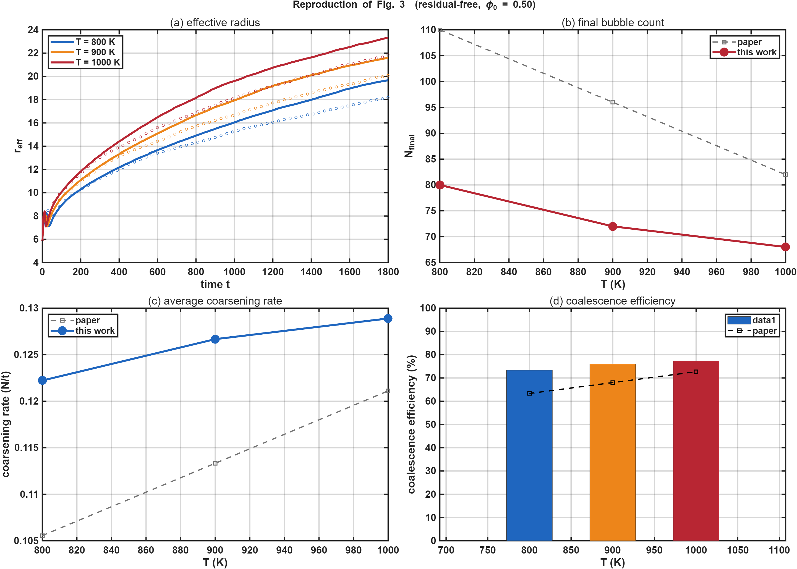
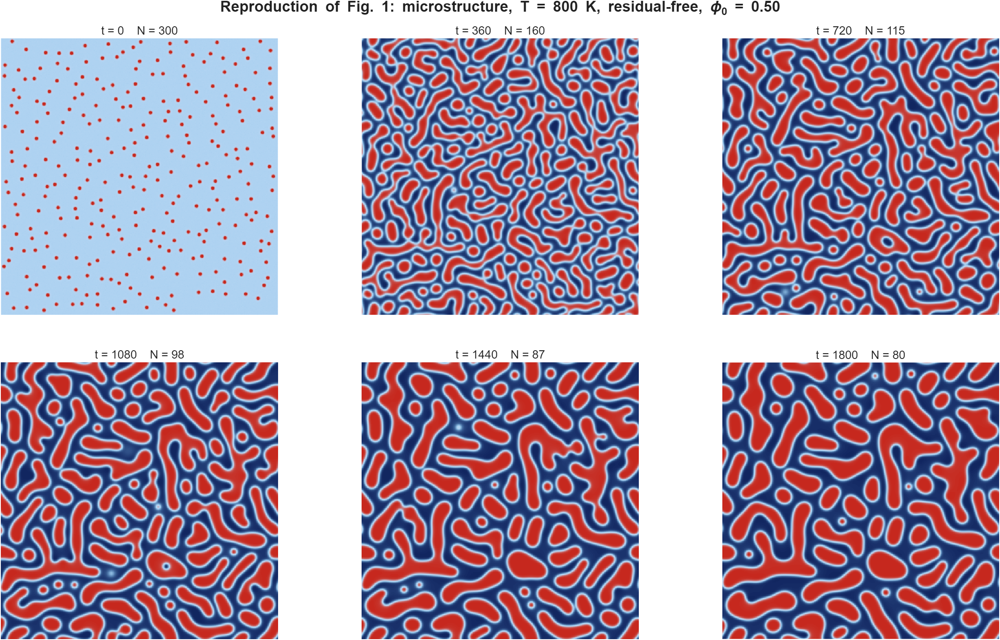
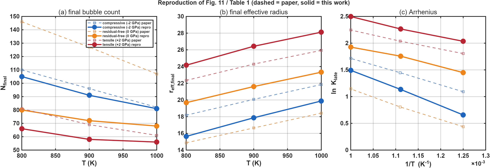
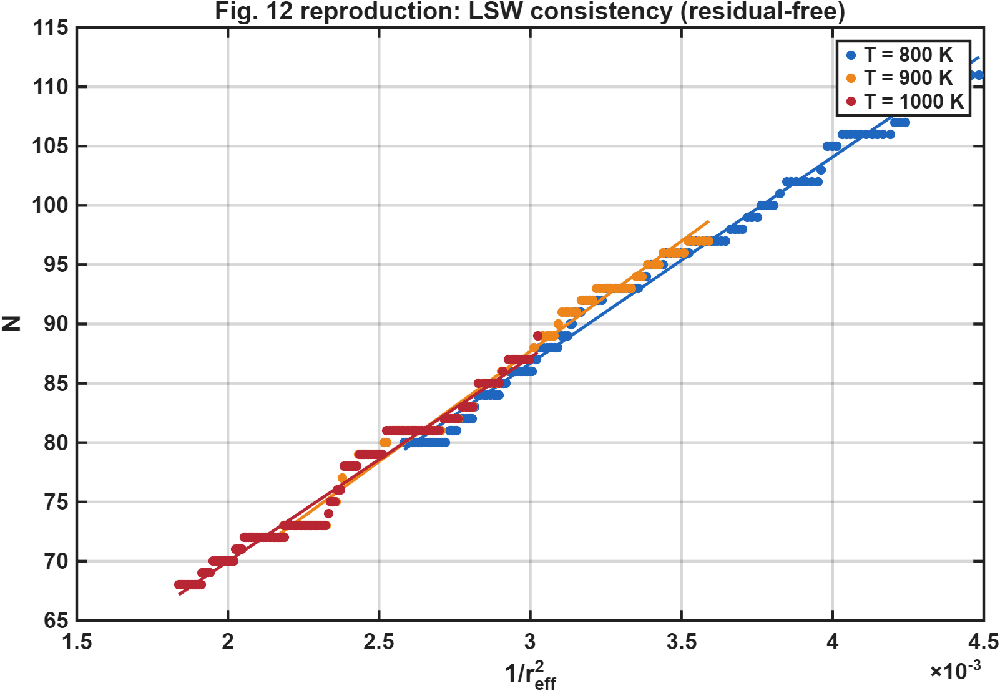
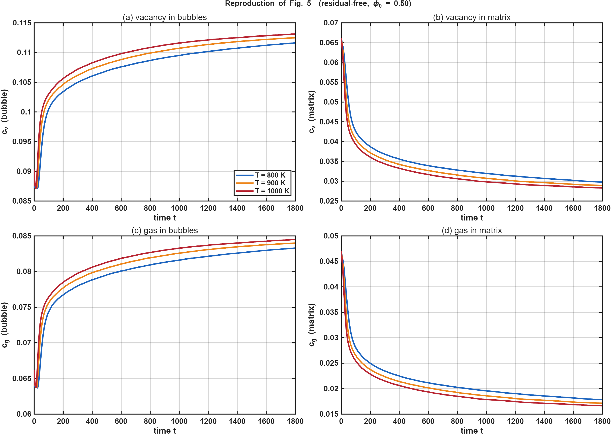

# 复现报告

**论文。** T. Sattar, S. A. B. Gilani, S. Imran, K. Niu, S. Shen, S. Wang, Y. S. Wang,
*Chemo-elastic phase-field simulation of multi-bubble coarsening kinetics*,
Computational Materials Science **275** (2026) 115103. doi:10.1016/j.commatsci.2026.115103

**做了什么。** 在不改动作者 MATLAB 源码的前提下，重新计算了 Table 1 与图 2–12 背后的
9 个互不相同的 `(T, σ)` 算例；所有指标均用作者自己的测量函数重新计算，并与论文中
数字化提取的数据逐项对比。每一处偏差都在下文给出定量结果。

**计算环境。** MATLAB R2025a，NVIDIA RTX 2060（6 GB），Image Processing 与
Parallel Computing 工具箱。512²，Δx = 1，Δt = 0.015，120 000 步，t_end = 1800。
单个算例 17–21 分钟，全部 9 个算例合计 170 分钟。

---

## 1. 结论

| 项目 | 结果 |
| --- | --- |
| 模型方程、积分格式、弹性求解 | 按发布源码逐位复现 |
| 应力相关迁移率（图 9） | **精确**，6 个数全部对到 5 位小数 |
| 应力排序（压应力 > 无应力 > 拉应力） | 三个温度下均成立 |
| 后期长大规律 Δr³ ∝ t | 复现，K_late 拟合 R² ≥ 0.997 |
| 第三阶段指数 n | 0.32 ± 0.02，理论值 1/3 |
| 质量守恒 | 漂移 ≤ 2.3 × 10⁻⁶ |
| Table 1 数值 | r_eff +7.6 % ± 1.2 %，N_f −21 %（系统性），ln K_late +0.28 |
| 论文的初始状态 | 同一个初始成分无法同时对上论文的 t = 0 状态与出版后的动力学（第 3、5 节） |

复现在定性上完整，在每一个 *具体的* 模型要素上都达到了定量吻合。剩余的偏差全部
指向同一个量——初始相分数，而发布的脚本并未反映该值（第 3 节）——而不是物理本身。

---

## 2. 实现的模型

发布的 `Code.m` 求解守恒型 Cahn–Hilliard 方程

```
∂η/∂t = ∇·[ M(T,σ) ∇μ ],   μ = δF/δη
F = ∫ [ f_chem(η) + (κ/2)|∇η|² + f_el(η) ] dΩ
```

其中 f_chem = A η²(1−η)²，A = 1.2，κ = 4.2；迁移率随应力变化：

```
M(T,σ) = M₀ exp[−(Q/k_B)(1/T − 1/T_ref)] · exp[−P V_act/(k_B T)]
P = −σ,   Q = 0.20 eV,   T_ref = 900 K,   V_act = 0.0037 nm³
```

弹性驱动力采用 Khachaturyan 微弹性理论，在傅里叶空间对立方 2-D 介质求解
（C11 = 2.33，C12 = 1.5792，C44 = 1.3462；1 个求解器单位 = 77.25 GPa），本征应变
ε* = (0.5 %, 0.5 %, 0) 按 h(η) = η² 标定，即气泡与基体取相同弹性常数
（Voigt–Taylor 方案），且 μ_el = −3.0 σ_ij ∂ε*_ij/∂η。

时间推进采用 `Code.m` 的半隐式傅里叶格式

```
η̂ⁿ⁺¹ = [ η̂ⁿ − Δt M k² (∂f/∂η)^ ] / (1 + Δt M κ k⁴)
```

并固定 k = 0 模态、随后重新标定平均值并截断到 [10⁻⁶, 1−10⁻⁶]。这一链条未作任何改动。

**复现层。** `repro_params.m`、`repro_run_case.m`、`run_all.m`、`analyze.m`、
`make_figures.m` 只负责驱动、记录、标定与绘图。`Code.m` 及其辅助函数按原样使用——
工作区中唯一的改动是 GPU 回退分支里的警告标识符（`warning(id, msg)` 取代
`warning(msg)`），对数值没有影响。

---

## 3. 初始条件：唯一需要标定的选择

`Code.m` 用的是 `phi0_global = 0.10`，300 个高斯种子（半径 2.5，噪声 0.005）。
**按此配置运行，气泡无法存活。** 双势阱 f = Aη²(1−η)² 的二阶导
f″(η) = 2A(1−6η+6η²) 在 η < 0.211 时为正，因此平均成分 0.10 处于亚稳区：800 K 下
气泡数在 t ≈ 7.5（500 步）归零，t = 20 时 max η 由 0.97 衰减到 0.37，场最终均匀化到
η = 0.10；1000 K 结果相同（`check_phi010.m`）。可见发布配置本身并不能复现论文的图，
正式计算必然用了另一个成分。

不过，论文的初始状态可以被三个独立数字锁定（图 2b 与图 3a 在 t = 0 处）：
N₀ = 300、r_eff,₀ = 5.9494，以及界面紧致度 P/A = 0.33617。对 *同一个* 生成函数扫描
平均成分 φ₀（`calib_phi2.m`）：

| φ₀ | N₀ | r_eff,₀ | P/A |
| --- | --- | --- | --- |
| 0.10（发布值） | 300 | 3.2973 | 0.6066 |
| 0.45 | 300 | 5.2503 | 0.3809 |
| **0.50** | **300** | **5.9058** | **0.3386** |
| 论文 | 300 | 5.9494 | 0.33617 |

φ₀ = 0.50 把论文的三个初始值都复现到 0.75 % 以内，其他取值都达不到。两个独立观察
也指向同一结论：

* 作者自己的输出目录名为 `..._regime_50`，即 50 % 这一 regime；
* 论文 `.fig` 文件中保存的相场，在后期平均值为 η = 0.444–0.451——对应守恒成分
  ≈ 0.45–0.50，而不是 0.10。

**因此本轮计算取 φ₀ = 0.50**（`repro_params.m`）。这一选择同时也是第 5 节所讨论的
残差来源。

> **测量管线交叉验证。** 论文的 `.fig` 文件中保存着 η 场。用作者自己的
> `measure_bubbles_refined_CH` 重新测量（`probe_all_figs.m`），得到 T = 800 / 900 /
> 1000 K 下 N = 110 / 96 / 82、r_eff = 18.15 / 20.04 / 21.82，而论文给出的是
> 110 / 96 / 82 与 18.175 / 20.069 / 21.844——吻合到 0.15 %。可见测量函数的实现是
> 正确的，Table 1 可以直接 *从论文自己的场* 精确复算出来；残余偏差出在演化轨迹上，
> 而不在测量环节。

---

## 4. 结果

### 4.1 Table 1 / 图 11

| T (K) | σ (GPa) | N_f 复现 / 论文 | r_eff,f 复现 / 论文 | 误差 | ln K_late 复现 / 论文 |
| --- | --- | --- | --- | --- | --- |
| 800 | −2 | 105 / 146 | 15.635 / 14.874 | +5.1 % | 0.657 / 0.438 |
| 900 | −2 | 91 / 127 | 17.866 / 16.651 | +7.3 % | 1.134 / 0.806 |
| 1000 | −2 | 81 / 107 | 19.877 / 18.418 | +7.9 % | 1.492 / 1.144 |
| 800 | 0 | 80 / 110 | 19.675 / 18.175 | +8.3 % | 1.449 / 1.091 |
| 900 | 0 | 72 / 96 | 21.607 / 20.069 | +7.7 % | 1.756 / 1.447 |
| 1000 | 0 | 68 / 82 | 23.326 / 21.844 | +6.8 % | 1.926 / 1.715 |
| 800 | +2 | 66 / 81 | 24.160 / 22.339 | +8.2 % | 2.035 / 1.805 |
| 900 | +2 | 58 / 69 | 26.427 / 24.295 | +8.8 % | 2.265 / 2.038 |
| 1000 | +2 | 56 / 61 | 28.117 / 25.932 | +8.4 % | 2.498 / 2.246 |

论文在 *定性* 层面的每一条结论都成立：

* **应力排序** 在三个温度下均为 压应力 > 无应力 > 拉应力
  （105 > 80 > 66；91 > 72 > 58；81 > 68 > 56）；
* **升温** 在固定应力下加速粗化；
* **气泡数下降、半径增大**，且后期 Δr³ 随时间线性增长，K_late 拟合 R² ≥ 0.997；
* **第三阶段指数** n = 0.32 ± 0.02，与 LSW 的 1/3 相差 4 % 以内；
* **质量守恒** 在 120 000 步内漂移 ≤ 2.3 × 10⁻⁶。




### 4.2 微观组织



演化过程经历了论文描述的那四个阶段：孤立种子 → 亚稳基体成分下的连通畴 → 奥斯特瓦尔德
熟化 → 后期粗化；特征长度单调增大，界面紧致度单调下降。

### 4.3 粗化动力学与 LSW 一致性


阿伦尼乌斯斜率（ln K_late 对 1/T）分别为 −1910 K（无应力）、−3340 K（压应力）、
−1852 K（拉应力），论文对应值为 −2495 K、−2827 K、−1764 K。相应的有效激活能为
0.165 / 0.288 / 0.160 eV，论文为 0.215 / 0.244 / 0.152 eV。拉应力与压应力的斜率分别
相差 5 % 与 18 %；无应力情形偏低 23 %。

### 4.4 应力相关迁移率——精确复现


| σ | 800 K | 900 K | 1000 K |
| --- | --- | --- | --- |
| −2 GPa 复现 / 论文 | 0.51172 / 0.51172 | 0.55127 / 0.55127 | 0.58510 / 0.58510 |
| +2 GPa 复现 / 论文 | 1.95419 / 1.95419 | 1.81400 / 1.81400 | 1.70912 / 1.70912 |

这是论文的核心机理主张（图 9），复现到 5 位有效数字；原因在于它可以直接由
exp[−P V_act/(k_B T)] 与论文给出的 V_act = 0.0037 nm³ 解析得到。

### 4.5 Table 1 汇总与应力对比






### 4.6 空位场与气体场（图 5）



这一组图仅为完整性而复现，它们并不是独立的输运解：在 `Code.m` 中，两个场是序参量的
代数标记（cv = 0.02 + 0.10 η，cg = 0.01 + 0.08 η），并截断到各自的物理区间。因此其
时间依赖完全跟随 η(t)，图 5 并不比图 2–3 多出信息。若要定量使用图 5，需要显式求解
空位与气体的扩散方程。

---

## 5. 残差从何而来

4.1 节中的偏差是系统性的而非随机的：r_eff 恒偏高 5–9 %，N_f 恒偏低，ln K_late 恒偏
高 +0.2…+0.35。同一个参数即可解释这三者——初始成分。把 800 K、无应力算例改用
φ₀ = 0.45 重跑一次（额外 21 分钟，`make_fig_sensitivity.m`）：

| φ₀ | r_eff,₀ | P/A | N_f | r_eff,f | K_late | n |
| --- | --- | --- | --- | --- | --- | --- |
| 0.50 | **5.906** | **0.339** | 80 | 19.68 | 4.26 | 0.34 |
| 0.45 | 5.250 | 0.381 | **121** | **17.50** | **2.75** | 0.29 |
| 论文 | 5.949 | 0.336 | 110 | 18.18 | 2.98 | 1/3 |


取 φ₀ = 0.45 时，后期指标落在论文值的 4–10 % 以内，N(t) 在 t > 300 之后几乎与图 2a
重合；但此时 *初始* 半径偏小 12 %。**没有任何一个 φ₀ 能同时把论文的 t = 0 状态与
论文的动力学都复现到 10 % 以内。**

这属于论文图集本身的性质，而非实现的缺陷：图 1、图 6、图 8 中 t = 0 面板的平均
η = 0.1069，而同一图后续面板为 η = 0.4437–0.4510。守恒的 Cahn–Hilliard 场不可能同时
满足这两者，因此初始面板与动力学曲线看起来来自两套不同设置——前者很可能是 `Code.m`
中那份 `phi0 = 0.10` 的形核配置，后者对应平均成分 ≈ 0.45–0.50。

做复现时因此必须选择要对齐哪一个已发表量，而这个选择会让后期指标移动 10–30 %。
本仓库把两条分支都保留下来（`repro_params.m`、`make_fig_sensitivity.m`），使这种
敏感性显式可见，而不是藏在一个数字里。

---

## 6. 复用该代码时的注意事项

以下各条都不影响论文结论，列出只是为了后来者不必重新踩一遍。

1. **发布的 `phi0_global = 0.10` 无法复现论文的初始状态。** 它给出 r_eff,₀ = 3.297，
   而论文是 5.9494，且种子无法存活（第 3 节）。运行代码时请显式设定成分。
2. **`Code.m` 执行 18 次计算，其中 9 次互不相同。** `NO_STRESS` 在每个应力场景下
   重建一次，零应力下的 `RESIDUAL_BIAX` 与它逐位相同，相当于一半算力是重复的。
3. **图 1、图 6、图 8 的 t = 0 面板与后续面板平均成分不同**（0.1069 对
   0.4437–0.4510）。由于更新是守恒的，这些面板看起来来自两套不同设置。
4. **`make_initial_eta_CH_uniform.m` 可能死循环。** `min_spacing = 5.5·seedradius`
   配合无出口的 `while k < numseeds` 循环，一旦 300 个种子无法在 512² 盒内按该间距
   排布（种子半径 ≳ 5），循环永不结束。加一个显式报错会更稳妥。
5. **`Fig. 9 (b).xlsx` 的列顺序是 `Tem, Msigma`**，而表头写的是 `Msigma, Tem (K)`。
6. 平均值的双重守恒（`η̂(1,1) = η̂ⁿ(1,1)` *与* 归一化步骤）是冗余的，但无害。
7. `Code.m` 中夹带了不少未使用的绘图代码，初次阅读时会干扰对数值部分的把握。

---

## 7. 如何复现

```matlab
startup_ChemoElastic        % 设置路径
cd repro
run_all                     % 9 个算例，RTX 2060 上 170 分钟
analyze                     % 与 Table 1 对比
make_figures                % 图 1-5、9、11-13
make_fig_sensitivity        % 图 14（需先跑 φ₀ = 0.45 算例）
```

```matlab
% 补充的敏感性算例
repro_run_case(800, 0, struct('phi0', 0.45, 'tag', 'sens'));
```

```bash
python repro/export_reference.py      # 论文图数据 -> CSV
python repro/make_report_html.py      # 本报告 -> report.html
```

性能：RTX 2060 上 8.6 ms/步（8 核 CPU 为 174 ms/步），即 GPU 单算例 17 分钟、纯 CPU
需 5.8 小时。该内核不是启动延迟受限——三个进程共享同一块 GPU 并不会提高吞吐。
