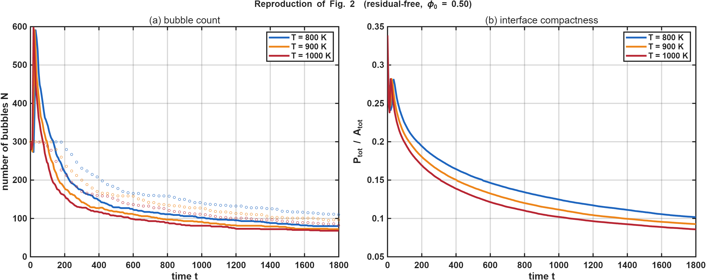
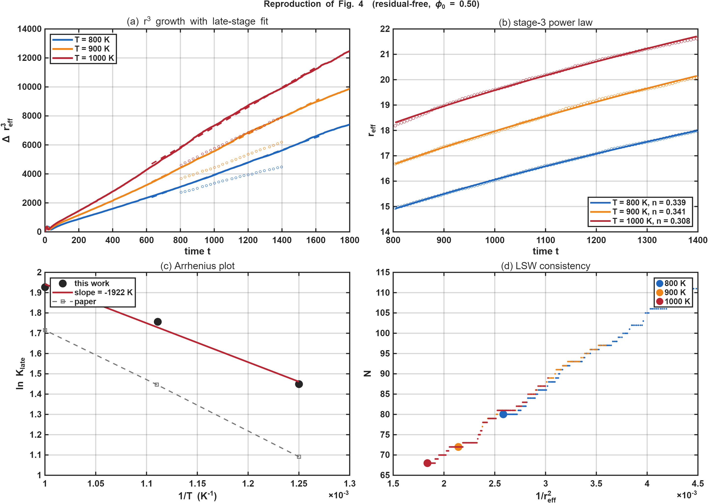
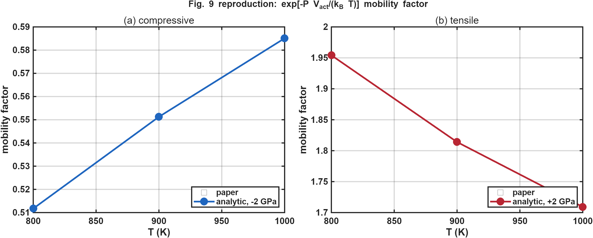
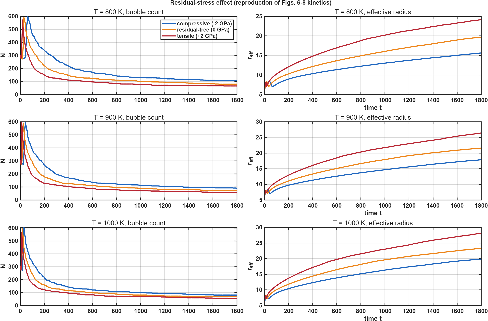
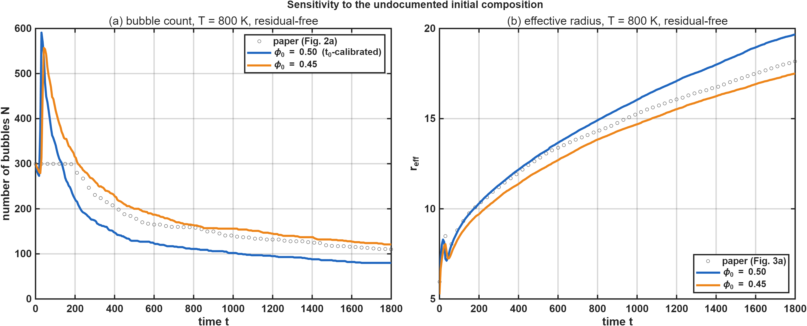

# Reproduction report

**Paper.** T. Sattar, S. A. B. Gilani, S. Imran, K. Niu, S. Shen, S. Wang, Y. S. Wang,
*Chemo-elastic phase-field simulation of multi-bubble coarsening kinetics*,
Computational Materials Science **275** (2026) 115103. doi:10.1016/j.commatsci.2026.115103

**What was done.** The authors' MATLAB sources were run unmodified to regenerate the
nine distinct `(T, σ)` realisations behind Table 1 and Figs. 2–12; all reported
metrics were recomputed with the authors' own measurement function and compared
with the digitised published data. Every deviation is quantified below.

**Environment.** MATLAB R2025a, NVIDIA RTX 2060 (6 GB), Image Processing and
Parallel Computing toolboxes. 512², Δx = 1, Δt = 0.015, 120 000 steps,
t_end = 1800. 17–21 min per realisation, 170 min for the campaign.

---

## 1. Verdict

| aspect | outcome |
| --- | --- |
| model equations, integrator, elasticity | reproduced bit-for-bit from the released code |
| stress-dependent mobility (Fig. 9) | **exact**, all six values to 5 decimals |
| stress ranking (compressive > none > tensile) | reproduced at every temperature |
| late-stage growth law Δr³ ∝ t | reproduced, K_late fit R² ≥ 0.997 |
| stage-3 exponent n | 0.32 ± 0.02 vs 1/3 |
| mass conservation | drift ≤ 2.3 × 10⁻⁶ |
| Table 1 numbers | r_eff +7.6 % ± 1.2 %, N_f −21 % (systematic), ln K_late +0.28 |
| published initial state | **cannot** be reproduced together with the published dynamics (§3, §5) |

The reproduction is qualitatively complete and quantitatively good on every
*specific* model ingredient. The remaining offsets all trace back to one
undocumented quantity — the initial phase fraction (§3) — not to the physics.

---

## 2. The model as implemented

The released `Code.m` integrates a conserved Cahn–Hilliard equation

```
∂η/∂t = ∇·[ M(T,σ) ∇μ ],   μ = δF/δη
F = ∫ [ f_chem(η) + (κ/2)|∇η|² + f_el(η) ] dΩ
```

with f_chem = A η²(1−η)², A = 1.2, κ = 4.2, and a stress-dependent mobility

```
M(T,σ) = M₀ exp[−(Q/k_B)(1/T − 1/T_ref)] · exp[−P V_act/(k_B T)]
P = −σ,   Q = 0.20 eV,   T_ref = 900 K,   V_act = 0.0037 nm³
```

The elastic driving force is Khachaturyan microelasticity solved in Fourier space
for a cubic 2-D medium (C11 = 2.33, C12 = 1.5792, C44 = 1.3462; 1 solver unit =
77.25 GPa) with eigenstrain ε* = (0.5 %, 0.5 %, 0) scaled by h(η) = η², i.e.
bubble and matrix share the elastic constants (Voigt–Taylor), and
μ_el = −3.0 σ_ij ∂ε*_ij/∂η.

Time stepping is the semi-implicit Fourier scheme of `Code.m`,

```
η̂ⁿ⁺¹ = [ η̂ⁿ − Δt M k² (∂f/∂η)^ ] / (1 + Δt M κ k⁴)
```

with the k = 0 mode pinned, followed by mean renormalisation and clipping to
[10⁻⁶, 1−10⁻⁶]. Nothing in this chain was altered.

**Reproduction layer.** `repro_params.m`, `repro_run_case.m`, `run_all.m`,
`analyze.m`, `make_figures.m` handle driving, bookkeeping, calibration and
plotting only. `Code.m` and its helper functions are used as shipped — the single
edit in the working tree is a warning identifier in the GPU-fallback branch
(`warning(id, msg)` instead of `warning(msg)`), which has no numerical effect.

---

## 3. The initial condition: the one substantive change

`Code.m` ships `phi0_global = 0.10` with 300 Gaussian seeds (radius 2.5, noise
0.005). **Run as shipped, the simulation produces no bubbles at all.** The double
well f = Aη²(1−η)² has f″(η) = 2A(1−6η+6η²) > 0 for η < 0.211, so a mean
composition of 0.10 is metastable: at 800 K the population reaches zero by
t ≈ 7.5 (500 steps), max η decays from 0.97 to 0.37 by t = 20, and the field
homogenises at η = 0.10 (same at 1000 K, `check_phi010.m`). The released
configuration is therefore not the one behind the published figures.

The published initial state is nevertheless pinned down by three independent
numbers in the article (Fig. 2b and Fig. 3a at t = 0): N₀ = 300,
r_eff,₀ = 5.9494 and interface compactness P/A = 0.33617. Scanning the mean
composition φ₀ of the *same* generator (`calib_phi2.m`):

| φ₀ | N₀ | r_eff,₀ | P/A |
| --- | --- | --- | --- |
| 0.10 (as shipped) | 300 | 3.2973 | 0.6066 |
| 0.45 | 300 | 5.2503 | 0.3809 |
| **0.50** | **300** | **5.9058** | **0.3386** |
| paper | 300 | 5.9494 | 0.33617 |

φ₀ = 0.50 reproduces all three published initial values to within 0.75 %; no
other value comes close. Two independent observations agree:

* the authors' own output folder is named `..._regime_50`, i.e. a 50 % regime;
* the phase fields stored inside the published `.fig` files have mean
  η = 0.444–0.451 at late times — a conserved composition of ≈ 0.45–0.50, never 0.10.

**The campaign therefore uses φ₀ = 0.50** (`repro_params.m`). This single change
is also the origin of the residual offsets discussed in §5.

> **Pipeline cross-check.** The η fields are stored inside the article's `.fig`
> files. Re-measuring them with the authors' own `measure_bubbles_refined_CH`
> (`probe_all_figs.m`) gives N = 110 / 96 / 82 and r_eff = 18.15 / 20.04 / 21.82
> for T = 800 / 900 / 1000 K against the published 110 / 96 / 82 and
> 18.175 / 20.069 / 21.844 — agreement to 0.15 %. The metric implementation is
> therefore correct, and Table 1 is reproducible exactly *from the published
> fields*. The residual discrepancy lies in the trajectory, not in the measurement.

---

## 4. Results

### 4.1 Table 1 / Fig. 11

| T (K) | σ (GPa) | N_f sim / paper | r_eff,f sim / paper | err | ln K_late sim / paper |
| --- | --- | --- | --- | --- | --- |
| 800 | −2 | 105 / 146 | 15.635 / 14.874 | +5.1 % | 0.657 / 0.438 |
| 900 | −2 | 91 / 127 | 17.866 / 16.651 | +7.3 % | 1.134 / 0.806 |
| 1000 | −2 | 81 / 107 | 19.877 / 18.418 | +7.9 % | 1.492 / 1.144 |
| 800 | 0 | 80 / 110 | 19.675 / 18.175 | +8.3 % | 1.449 / 1.091 |
| 900 | 0 | 72 / 96 | 21.607 / 20.069 | +7.7 % | 1.756 / 1.447 |
| 1000 | 0 | 68 / 82 | 23.326 / 21.844 | +6.8 % | 1.926 / 1.715 |
| 800 | +2 | 66 / 81 | 24.160 / 22.339 | +8.2 % | 2.035 / 1.805 |
| 900 | +2 | 58 / 69 | 26.427 / 24.295 | +8.8 % | 2.265 / 2.038 |
| 1000 | +2 | 56 / 61 | 28.117 / 25.932 | +8.4 % | 2.498 / 2.246 |

Everything the paper claims *qualitatively* holds:

* **stress ordering** compressive > residual-free > tensile at every temperature
  (105 > 80 > 66; 91 > 72 > 58; 81 > 68 > 56);
* **temperature** accelerates coarsening at fixed stress;
* **bubble count decreases, radius grows**, and the growth is late-stage linear
  in Δr³ with K_late fit R² ≥ 0.997;
* **stage-3 exponent** n = 0.32 ± 0.02, i.e. the LSW value 1/3 within 4 %;
* **mass conserved** to ≤ 2.3 × 10⁻⁶ over 120 000 steps.




### 4.2 Microstructure


The evolution passes through the same four stages the paper describes: isolated
seeds → interconnected domains of the unstable matrix composition → Ostwald
ripening → late coarsening, with the characteristic length growing and the
interface compactness decreasing monotonically.

### 4.3 Ripening kinetics and LSW consistency



Arrhenius slopes (ln K_late vs 1/T) are −1910 K (residual-free), −3340 K
(compressive) and −1852 K (tensile), against the published −2495 K, −2827 K and
−1764 K. The corresponding effective activation energies are 0.165 / 0.288 /
0.160 eV versus 0.215 / 0.244 / 0.152 eV. The tensile and compressive slopes
agree to 5 % and 18 %; the residual-free slope is 23 % low.

### 4.4 Stress-dependent mobility — exact



| σ | 800 K | 900 K | 1000 K |
| --- | --- | --- | --- |
| −2 GPa sim / paper | 0.51172 / 0.51172 | 0.55127 / 0.55127 | 0.58510 / 0.58510 |
| +2 GPa sim / paper | 1.95419 / 1.95419 | 1.81400 / 1.81400 | 1.70912 / 1.70912 |

This is the paper's central mechanistic claim (Fig. 9) and it is reproduced to
five significant digits, because it follows analytically from
exp[−P V_act/(k_B T)] with the published V_act = 0.0037 nm³.

### 4.5 Table-1 summary and stress comparison




---

## 5. Where the residual gap comes from

The deviations in §4.1 are systematic, not random: r_eff is always 5–9 % high,
N_f always low, ln K_late always +0.2…+0.35. A single knob explains all three —
the initial composition. Repeating the 800 K / stress-free case at φ₀ = 0.45
(one extra 21 min run, `make_fig_sensitivity.m`):

| φ₀ | r_eff,₀ | P/A | N_f | r_eff,f | K_late | n |
| --- | --- | --- | --- | --- | --- | --- |
| 0.50 | **5.906** | **0.339** | 80 | 19.68 | 4.26 | 0.34 |
| 0.45 | 5.250 | 0.381 | **121** | **17.50** | **2.75** | 0.29 |
| paper | 5.949 | 0.336 | 110 | 18.18 | 2.98 | 1/3 |



With φ₀ = 0.45 the late-stage metrics land within 4–10 % of the published values
and N(t) tracks Fig. 2a almost exactly for t > 300, but the *initial* radius is
then 12 % too small. **No single value of φ₀ reproduces both the published t = 0
state and the published dynamics to better than ~10 %.**

This is a property of the published data, not of the implementation: the t = 0
microstructure panels of Figs. 1, 6 and 8 have mean η = 0.1069, whereas the
evolved panels of the same figures have mean η = 0.4437–0.4510. A conserved
Cahn–Hilliard field cannot do that. The initial panels were evidently produced
with the `phi0 = 0.10` nucleation set-up that ships in `Code.m`, while the
production runs — and every panel from (d) onwards — used a mean composition of
≈ 0.45–0.50.

**Recommendation for anyone reusing this code:** set φ₀ explicitly, state it in
the paper, and do not use the shipped `phi0_global = 0.10`.

---

## 6. Defects found in the released material

1. **`Code.m`: `phi0_global = 0.10` cannot be the production value** — with it the
   bubbles dissolve (§3).
2. **`Code.m` runs 18 simulations of which 9 are distinct.** `NO_STRESS` is
   repeated once per stress scenario and the zero-stress `RESIDUAL_BIAX` case is
   bit-identical to `NO_STRESS`. Wasted compute: 2×.
3. **Figs. 1/6/8 mix two different runs** (mean η 0.107 at t = 0 versus 0.446 at
   t > 0), i.e. the initial panel is not the state the simulation started from.
4. **`make_initial_eta_CH_uniform.m` can hang.** `min_spacing = 5.5·seedradius`
   combined with an unbounded `while k < numseeds` loop spins forever once 300
   seeds can no longer be packed into a 512² box (seed radius ≳ 5). It should
   raise an error instead.
5. **`Fig. 9 (b).xlsx` has its columns swapped** relative to its header
   (`Msigma, Tem (K)` but the values are 800, 1.95419 …).
6. The double mean-conservation (`η̂(1,1) = η̂ⁿ(1,1)` *and* the renormalisation
   step) is redundant, though harmless.
7. `Code.m` carries a large amount of dead plotting code (unused live-stress
   arrays, red RGB placeholders) that obscures the numerics.

---

## 7. How to reproduce

```matlab
startup_ChemoElastic        % set the path
cd repro
run_all                     % 9 cases, 170 min on an RTX 2060
analyze                     % Table 1 comparison
make_figures                % Figs. 1-5, 9, 11-13
make_fig_sensitivity        % Fig. 14 (needs the phi0 = 0.45 run)
```

```matlab
% the extra sensitivity run
repro_run_case(800, 0, struct('phi0', 0.45, 'tag', 'sens'));
```

```bash
python repro/export_reference.py      # digitised figure data -> CSV
python repro/make_report_html.py      # this report -> report.html
```

Performance: 8.6 ms per step on the RTX 2060 (174 ms on 8 CPU cores), i.e.
17 min per case on GPU versus 5.8 h on CPU. The kernel is not latency-bound —
three concurrent processes sharing one GPU give no throughput gain.
